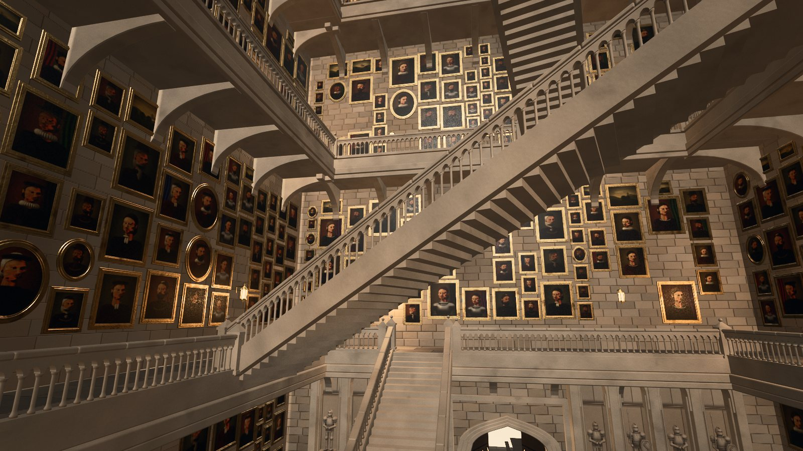
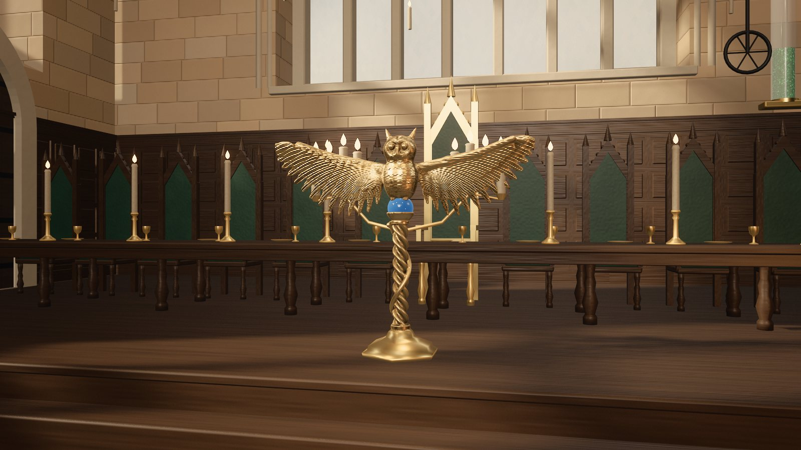

# Hogwarts Castle · a film replica in code

English · [中文](README.zh.md)

A Hogwarts built entirely in code. The whole piece is one web page written with three.js, with no 3D models, textures or
image assets: the castle, the cliffs, the Black Lake, eight thousand trees, the sky, the lit windows, the nine hundred
candles and the house banners in the Great Hall are all generated by the program. It follows the castle from the films
(the 1:24 shooting miniature at Leavesden) building by building, then matches it to photos of the miniature on Wikimedia
Commons by solving each photo's camera.

Produced by **dasungta** · built by **Opus 5.5** (Claude Code)

**Anyone interested is welcome to join in and help make it more detailed.** See [Join in](#join-in) below.

> **Unofficial fan project.** Not affiliated with or authorised by Warner Bros., J.K. Rowling or any rights holder of
> Harry Potter. The film design of the castle, its names and the house crests belong to their owners. For learning only,
> no commercial use. See [LICENSE-CONTENT.md](LICENSE-CONTENT.md).


<table>
<tr>
<td width="50%"><br>First sight from the lake, at night</td>
<td width="50%"><br>The Great Hall</td>
</tr>
<tr>
<td><br>The Grand Staircase: moving flights, arcaded balustrades and walls of portraits</td>
<td><br>The Wooden Bridge</td>
</tr>
<tr>
<td><br>The Quidditch pitch</td>
<td><br>The golden owl lectern on the Great Hall's dais</td>
</tr>
<tr>
<td><br>Hagrid's hut and the Whomping Willow</td>
<td><br>The page with the map open</td>
</tr>
</table>

## See it

- **Online**: <https://dasungta.github.io/hogwarts-replica/> (GitHub Pages; the scene takes about half a minute to build, best in Chrome on a computer)
- **Locally**: download [`dist/index.html`](dist/index.html) and open it in Chrome (it loads three.js and the fonts from the web).

Drag to orbit and scroll to zoom. In the toolbar at the bottom left, the shot menu (镜头) has 47 viewpoints, including the Great Hall, the
Grand Staircase and the Gryffindor common room inside. The map button (地图) opens the plan: click any building to fly there. The night button (夜晚)
switches to night with lit windows. The tour button (播放运镜) plays a camera tour from the train's arrival and the boats
across the lake to the Great Hall, then a flight over the grounds the next morning. When the view stops moving, the picture
keeps accumulating samples and gets cleaner the longer you wait. The interface is in Chinese.

## What's in it

- **46 buildings and places**: the Great Hall, the Grand Staircase Tower and the Headmaster's turrets, the Astronomy Tower,
  the Clock Tower and the Wooden Bridge, the viaduct, the Quad, the Hospital Wing, the Owlery, the north gatehouse and the
  curtain wall, the ruins, the greenhouses, the boathouse and its stairs, the stone circle, Hagrid's hut, the Whomping
  Willow, the Quidditch pitch, the Forbidden Forest, the Training Grounds, and on the south shore of the lake Hogsmeade
  Station and the Hogwarts Express
- **Three interiors**: the Great Hall (stone beasts holding fire bowls, the golden owl lectern, house banners, floating
  candles, the enchanted ceiling), the Entrance Hall with the moving Grand Staircase (gilt-framed portraits, suits of armour)
  and Gryffindor Tower: the common room (red millefleur tapestries, the great hooded fireplace with the house crest, velvet
  armchairs, Persian rugs, the brass chandelier, a game of wizard chess) and, up the spiral stair, the boys' dormitory
  (four-poster beds with red curtains, trunks with initials, the iron stove in its wire guard)
- **Five films that play in the page**: the camera tour by default; add `?cut=snitch` (an FPV flight following the Golden
  Snitch), `?cut=dusk` (dusk), `?cut=magic` (a spell of light) or `?cut=gryff` (a first-person walk through Gryffindor
  Tower at night in one unbroken shot: round the common room, up the spiral stair and into the dormitory) to the address
  and press the tour button. Storyboards (in Chinese) are in [docs/](docs/).

## How it was made

1. **References**: 234 photos from Wikimedia Commons, of the Leavesden miniature, the Great Hall and Gryffindor common room
   sets, the moving staircase prop, Goathland station and locomotive 5972. Each photo's author and licence is in `ref/*/SOURCES.json`. The miniature was
   used up to the eighth film, so the design follows films six to eight.
2. **One table**: `SITE` in `src/js/05-site.js` holds every building's position, name, sources and status. The map, the
   building list and the 3D scene are all drawn from it.
3. **A kit of parts**: round towers, square towers, cones with dormers, pointed windows, buttresses, pinnacles, battlements,
   a generic Gothic range and more. Every building is assembled from these parts. Materials are generated in shaders from
   world coordinates, including mortar joints, weathering and lichen.
4. **Matching photos**: mark a dozen or so landmarks on a photo and solve for the camera that took it (`tools/camsolve.py`).
   Render the replica from the same camera, compare it with the photo side by side or overlaid (`pair.py`, `overlay.py`),
   then correct positions and proportions.
5. **Sculpture and painting**: the stone beasts, the owl lectern and the suits of armour are sculpted as signed distance
   fields (SDF) and then meshed. The portraits are ray-marched busts on the GPU, given an oil-paint treatment. The house
   crests on the banners are painted stroke by stroke on a canvas, then embossed with stitches.
6. **Rendering**: offline-style accumulation. Each frame averages many jittered samples for anti-aliasing and soft
   shadows, and the lake renders a mirror image for every sample. Post-processing adds bloom, AgX tone mapping, a film
   grade and automatic levels.

The method was inspired by [Athenaion](https://github.com/Leonxlnx/athenaion) (@LexnLin): reference pictures → build each
one in code → compare side by side with the reference → fix.

## In numbers

- 21–28 October 2026, 8 days
- About 11,000 lines of JavaScript in 36 source files, plus about 2,200 lines of tools
- What changed in every version, and why, is in [docs/开发笔记.md](docs/开发笔记.md) (development notes, in Chinese)

## Join in

The producer and Claude made this in eight days, and it is still a long way from the castle in the films. If you love
Hogwarts too, know some three.js or shaders, or simply have a sharp eye and good reference photos, you are welcome to help
make it more detailed.

Things to do:

- **Interiors**: besides the Great Hall, the Grand Staircase and Gryffindor Tower, 11 rooms are not built yet:
  the Headmaster's office, the library and the Restricted Section, the Potions classroom, the top of the
  Astronomy Tower, the Room of Requirement, the hospital wing ward, the Defence Against the Dark Arts classroom, the
  Transfiguration classroom, the Chamber of Secrets, the Slytherin common room and the trophy room
- **Building detail**: keep checking the proportions, windows, roofs and carving of the 46 buildings against photos of the
  miniature. Many of them are close, but not yet the same
- **Grounds and nature**: the look of the Forbidden Forest, the Black Lake, the cliffs, the grass and the trees
- **Performance**: make it open smoothly on laptops and phones
- **Spotting mistakes**: if something differs from the films or sits in the wrong place, open an issue, ideally with a
  reference photo under a free licence

How to take part:

1. Open an issue first and say which part you would like to work on, so that people don't collide.
2. Read "地图和建筑清单" (the map and building list) and "踩过的坑" (pitfalls) in [docs/开发笔记.md](docs/开发笔记.md).
   Buildings are registered in the `SITE` table in `src/js/05-site.js`; the parts are in `src/js/40-kit.js` and `45-range.js`.
3. When you are done, render before and after stills from the same viewpoint with `tools/shot.mjs` and put them in the
   pull request together with the reference photo (`tools/pair.py` puts them side by side).

Ground rules:

- Code only: no 3D models, textures, film stills or film music.
- Reference photos must have a free licence (for example from Wikimedia Commons), with their sources recorded in
  `ref/*/SOURCES.json`.
- It stays an unofficial, non-commercial fan project. Code you contribute is released under MIT, text and images under
  CC BY-NC 4.0.

## Run it locally

You need Node.js 22 or later and Chrome. Rendering films also needs ffmpeg, and the photo-matching tools need Python 3
(`pip install -r requirements.txt`).

```bash
npm install
node tools/serve.mjs 8747
node tools/build.mjs
```

The first command installs three.js and nothing else. The second starts a local server at <http://localhost:8747> that
rebuilds the page on every reload. The third writes the single file `dist/index.html`.

Stills and films are rendered in headless Chrome on the GPU:

```bash
node tools/shot.mjs --shot front --spp 32 --w 1920 --h 1080 --out out/front.png
node tools/film.mjs --spp 8 --w 1920 --h 1080 --out out/snitch --name hogwarts-snitch --params cut=snitch
```

If Chrome is not in its usual place, set the `CHROME` environment variable to its path. The films come out silent; score
them with music you have the right to use.

Address parameters work online and locally, for example <https://dasungta.github.io/hogwarts-replica/?shot=front&night=1>: `shot=` a viewpoint (`front`, `hall`, `stair`, `quidditch` and the rest of the shot menu),
`night=1` night, `map=1` open the map, `cut=snitch|dusk|magic|gryff` choose the film, `grade=natural` turn off the film grade.

The reference photos can be downloaded again: `python -I tools/commons_fetch.py ref/model --restore` (likewise for the
other folders in `ref/`).

## Layout

```
src/page.html        the page shell: interface, styles, three.js import
src/js/*.js          joined in file-name order into one module: 00 engine; 05 site table; 10–20 materials and sky;
                     30 terrain; 40–59 castle; 61 station and train; 62–66 interiors and sculpture; 69–71 plants;
                     80–85 rendering; 87–89 films; 90 main
tools/               page assembly, local server, stills and films, photo matching; tools/blender/ is an export-to-Blender trial
docs/                development notes and the storyboards of the four films (in Chinese)
dist/index.html      the assembled single file
ref/*/SOURCES.json   the list of reference photos (the photos themselves are not in the repository)
```

## Licence

Code under MIT ([LICENSE](LICENSE)); documents and images under CC BY-NC 4.0. The castle design, names and crests are not
covered by either. See [LICENSE-CONTENT.md](LICENSE-CONTENT.md).

## Thanks

- [three.js](https://threejs.org/)
- The photographers who shared photos of the sets and the miniature on Wikimedia Commons, listed in `ref/*/SOURCES.json`
- The Harry Potter Wiki; LEGO set 76419 and Brickset's review, used to check the names and positions of buildings
- The approach of [Athenaion](https://github.com/Leonxlnx/athenaion)
