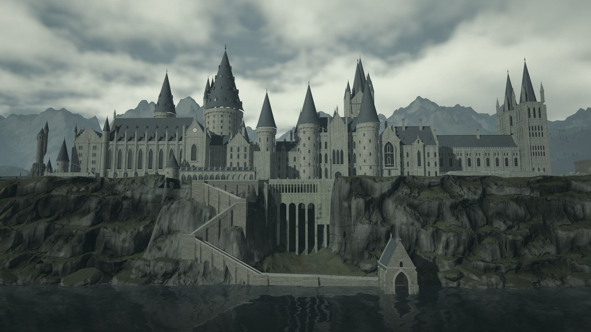
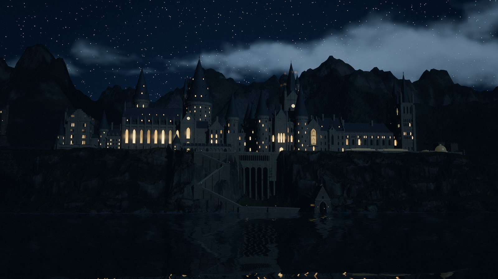
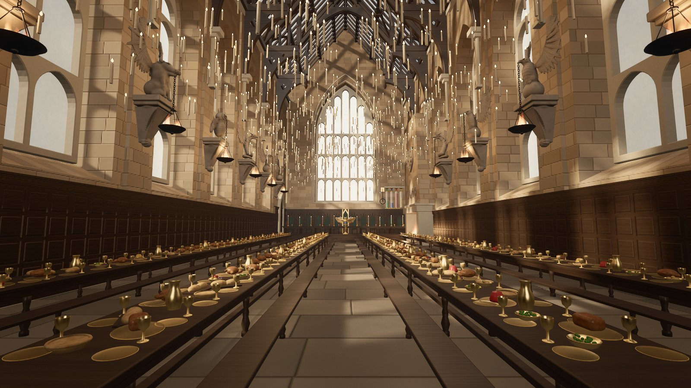
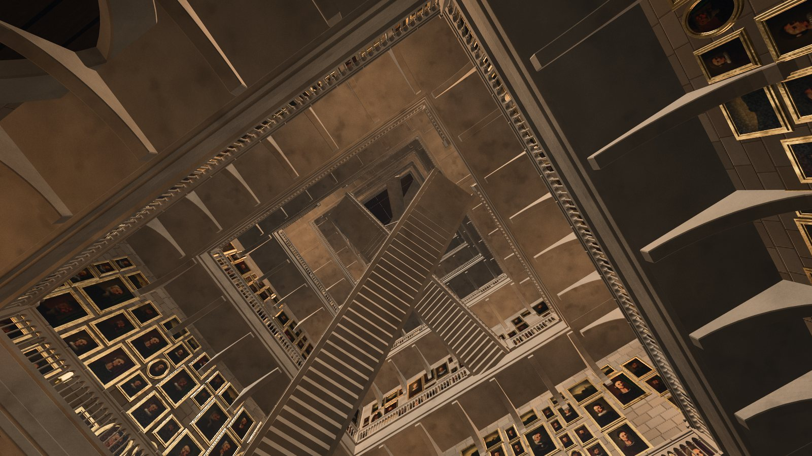
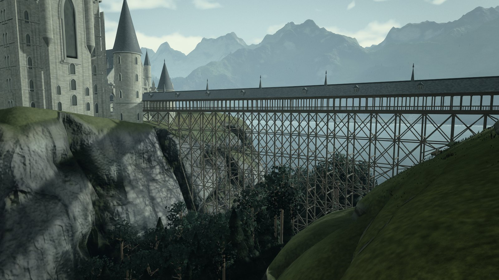
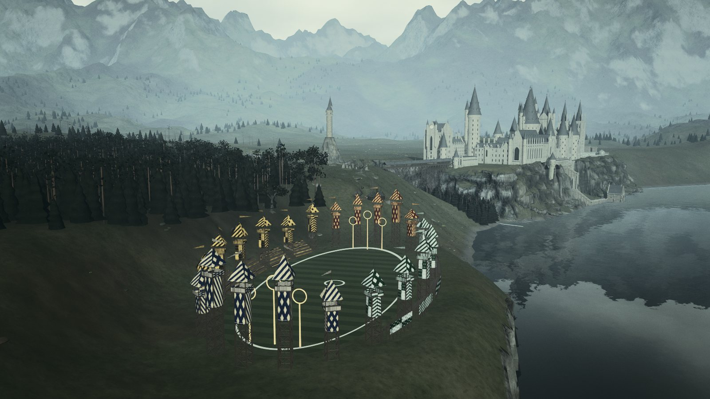
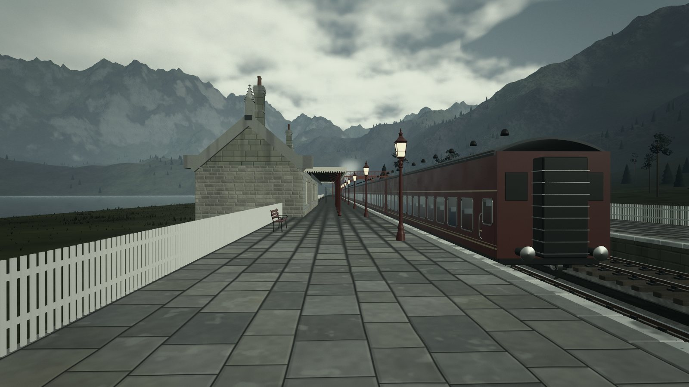
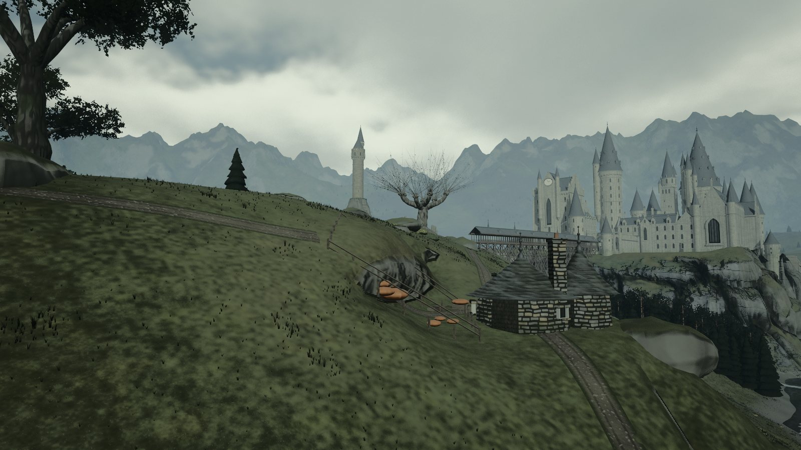
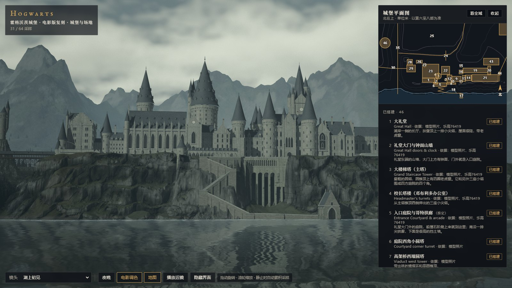

# 霍格沃茨城堡 · 电影版复刻

[English](README.md) · 中文

一座完全用代码搭出来的霍格沃茨。整个作品就是一个网页文件，用 three.js 写成，没有任何三维模型、贴图或图片素材：
城堡、山崖、黑湖、八千棵树、天空、窗里的灯、礼堂里的九百支蜡烛和学院旗，全部由程序生成。
照着电影里的城堡（利维斯登片场 1:24 的拍摄模型）一栋一栋复刻，再用维基共享资源上的模型照片反求相机，逐张对位修改。

出品人 **dasungta** · 制作 **Opus 5.5**（Claude Code）

> **非官方同人项目。** 与华纳兄弟、J.K. 罗琳及《哈利·波特》的权利人没有任何关系，也没有得到授权。
> 城堡的电影造型、名称和院徽归各自的权利人所有。仅供学习交流，不得商用。详见 [LICENSE-CONTENT.md](LICENSE-CONTENT.md)。



<table>
<tr>
<td width="50%"><br>夜里，湖上初见</td>
<td width="50%"><br>大礼堂</td>
</tr>
<tr>
<td><br>会转动的大楼梯</td>
<td><br>木廊桥</td>
</tr>
<tr>
<td><br>魁地奇球场</td>
<td><br>霍格莫德车站和霍格沃茨特快</td>
</tr>
<tr>
<td><br>海格小屋和打人柳</td>
<td><br>页面和平面图</td>
</tr>
</table>

## 在线看

- **在线版**：<https://dasungta.github.io/hogwarts-replica/>（GitHub Pages；打开后要等半分钟左右搭建场景，用电脑上的 Chrome 效果最好）
- **本地**：下载 [`dist/index.html`](dist/index.html)，用 Chrome 打开（需要联网加载 three.js 和字体）。

页面上可以拖动旋转、滚轮缩放。左下角的工具栏里，"镜头"菜单有 38 个机位，室内的大礼堂和大楼梯也在里面；"地图"打开平面图，
点哪一栋就飞到哪一栋；"夜晚"切换昼夜，夜里窗户亮灯；"播放运镜"从火车进站、坐船过湖一路看到大礼堂，第二天清晨再飞越全城。
画面停下来时会继续累积采样，越停越清晰。

## 有什么

- **46 处建筑和场地**：大礼堂、大楼梯塔和校长塔楼、天文塔、钟楼和木廊桥、高架桥、四方庭院、医院翼、猫头鹰棚屋、
  北门楼和城墙、废墟、温室、船屋和石阶、石圈、海格小屋、打人柳、魁地奇球场、禁林、训练场，还有黑湖南岸的霍格莫德车站和霍格沃茨特快
- **两处室内**：大礼堂（石兽火盆、金色猫头鹰讲台、院旗、漂浮的蜡烛、施了魔法的天花板）；门厅和会转动的大楼梯（金框肖像、盔甲骑士）
- **四段可以在页面里播放的影片**：默认是镜头巡游；网址加 `?cut=snitch`（跟着金色飞贼的穿越机视角）、`?cut=dusk`（黄昏）
  或 `?cut=magic`（魔法光）再点"播放运镜"。分镜在 [docs/](docs/)。

## 怎么做的

1. **参考**：维基共享资源上 217 张照片，包括利维斯登的拍摄模型、大礼堂片场、移动楼梯实物、高斯兰车站和 5972 号机车。
   每张的作者和许可记在 `ref/*/SOURCES.json`。拍摄模型一直用到第八部，所以造型以第六到第八部为准。
2. **一张表**：`src/js/05-site.js` 里的 `SITE` 记下每栋楼的位置、名字、依据和状态。地图、清单和三维场景都从这张表来。
3. **构件库**：圆塔、方塔、带老虎窗的锥顶、尖拱窗、扶壁、小尖塔、雉堞、通用的哥特楼……每栋楼都由构件拼成。
   材质在着色器里按世界坐标生成，包括砌缝、风化和地衣。
4. **对位**：在照片上标十几个标志点，反求出拍这张照片的相机（`tools/camsolve.py`）。再用同一个相机渲染复刻，
   和照片并排或叠在一起比较（`pair.py`、`overlay.py`），然后修改位置和比例。
5. **雕塑和绘画**：石兽、猫头鹰讲台、盔甲骑士都是先用有符号距离场（SDF）雕出来，再转成网格。肖像先在显卡上光线步进出
   立体胸像，再做油画处理。院旗上的院徽在画布上一笔一笔画出来，再压出凸起和针脚。
6. **渲染**：离线式累积渲染。每帧做多次抖动采样再取平均，得到抗锯齿和软阴影；湖面每个采样渲染一次镜像。
   后期有泛光、AgX 色调映射、电影调色和自动色阶。

方法受 [Athenaion](https://github.com/Leonxlnx/athenaion)（@LexnLin）启发：参考图 → 用代码逐张施工 → 和参考图并排比较 → 修改。

## 制作数据

- 2026 年 10 月 21 日到 28 日，共 8 天
- 约 1.1 万行 JavaScript（36 个源文件），另有约 2200 行工具脚本
- 每一版改了什么、为什么改，都记在 [docs/开发笔记.md](docs/开发笔记.md)

## 本地运行

需要 Node.js 22 以上和 Chrome。渲染视频还要 ffmpeg，对位工具要 Python 3（`pip install -r requirements.txt`）。

```bash
npm install
node tools/serve.mjs 8747
node tools/build.mjs
```

第一行只安装 three.js。第二行启动本地服务，打开 <http://localhost:8747>，每次刷新都会重新拼页面。第三行拼出单文件 `dist/index.html`。

出图和出片用无头 Chrome，靠显卡渲染：

```bash
node tools/shot.mjs --shot front --spp 32 --w 1920 --h 1080 --out out/front.png
node tools/film.mjs --spp 8 --w 1920 --h 1080 --out out/snitch --name hogwarts-snitch --params cut=snitch
```

Chrome 不在默认位置时，用环境变量 `CHROME` 指定路径。影片出来是没有声音的，配乐请用你自己有权使用的音乐。

网址参数在线版和本地都能用，比如 <https://dasungta.github.io/hogwarts-replica/?shot=front&night=1>：`shot=` 机位（`front`、`hall`、`stair`、`quidditch` 等，和"镜头"菜单一致）、`night=1` 夜晚、`map=1` 打开地图、
`cut=snitch|dusk|magic` 换要播放的影片、`grade=natural` 关掉电影调色。

参考照片可以重新下载：`python -I tools/commons_fetch.py ref/model --restore`（`ref/` 下其他文件夹同理）。

## 目录

```
src/page.html        页面外壳：界面、样式、加载 three.js
src/js/*.js          按文件名顺序拼成一个模块：00 引擎；05 建筑表；10–20 材质和天空；30 地形；40–59 城堡；
                     61 车站和火车；62–66 室内和雕塑；69–71 植被；80–85 渲染；87–89 影片；90 主程序
tools/               拼页面、本地服务、出图出片、照片对位；tools/blender/ 是导出到 Blender 的试验
docs/                开发笔记、四段影片的分镜
dist/index.html      拼好的单文件
ref/*/SOURCES.json   参考照片清单（照片本身不在仓库里）
```

## 许可

代码按 MIT（[LICENSE](LICENSE)），文档和图片按 CC BY-NC 4.0。城堡造型、名称和院徽不在这两种许可的范围内。详见 [LICENSE-CONTENT.md](LICENSE-CONTENT.md)。

## 致谢

- [three.js](https://threejs.org/)
- 在维基共享资源上分享片场和模型照片的摄影师们，名单在 `ref/*/SOURCES.json` 里
- Harry Potter Wiki；乐高 76419 和 Brickset 的评测，用来核对建筑的名字和位置
- [Athenaion](https://github.com/Leonxlnx/athenaion) 的做法
